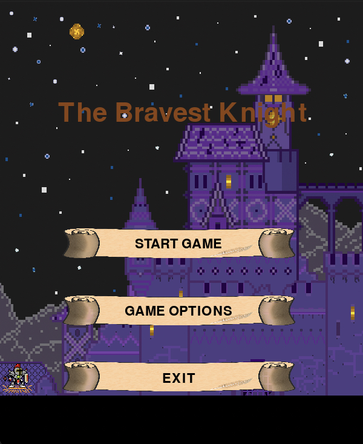
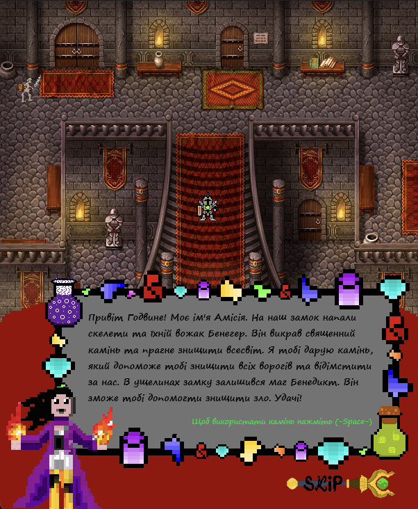

# The Bravest Knight

A 2D Python game built with Pygame.

## About

The Bravest Knight is a 2D game featuring a knight, enemies, game maps, animations, and interactive gameplay elements.

## Screenshot





## Technologies

- Python 3
- Pygame

## Installation

Clone the repository:

```bash
git clone https://github.com/0xGifre/The-Bravest-Knight.git
cd The-Bravest-Knight
```

Create a virtual environment:

```bash
python3 -m venv .venv
```

Activate it:

**macOS / Linux**
```bash
source .venv/bin/activate
```

**Windows**
```bash
.venv\Scripts\activate
```

Install dependencies:

```bash
pip install -r requirements.txt
```

## Run

```bash
python main.py
```

## Author

[0xGifre](https://github.com/0xGifre)
