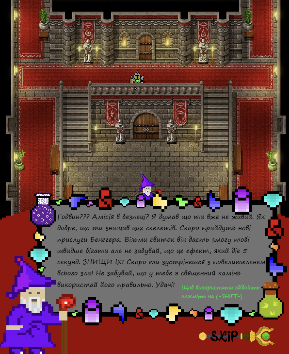

# The Bravest Knight

A 2D action game built with Python and Pygame, with custom pixel-art graphics and animations.

> Beta version, developed as a team project during the IT Step Academy Python course.

<p>
  
  
  
</p>

## About

The Bravest Knight is a 2D game featuring a knight, enemies, game maps, animations, and interactive gameplay elements. The game has a main menu, game options and a playable level, all built with object-oriented design.

## Features

- Playable knight character with animations
- Enemies and interactive gameplay elements
- Custom game maps
- Main menu with start, options and exit
- Original graphics and animations created by the team
- Object-oriented code structure

## My Role

Team of 4 developers. I was the **team lead**: I organized the workflow and deadlines in Trello, took part in architecture decisions, and contributed directly to development. [Add 1-2 concrete things you personally implemented, e.g. "player movement", "menu system", "enemy logic".]

## Technologies

- Python 3
- Pygame
- Git / GitHub
- Trello (task management)

## Installation

Clone the repository:

```bash
git clone https://github.com/0xGifre/The-Bravest-Knight.git
cd The-Bravest-Knight
```

Create a virtual environment:

```bash
python3 -m venv .venv
```

Activate it:

**macOS / Linux**
```bash
source .venv/bin/activate
```

**Windows**
```bash
.venv\Scripts\activate
```

Install dependencies:

```bash
pip install -r requirements.txt
```

## Run

```bash
python main.py
```

## Project Status

The game is a beta version and is not finished. Possible next steps: more levels, more enemy types, sound, and a save system.

## Author

[0xGifre](https://github.com/0xGifre)